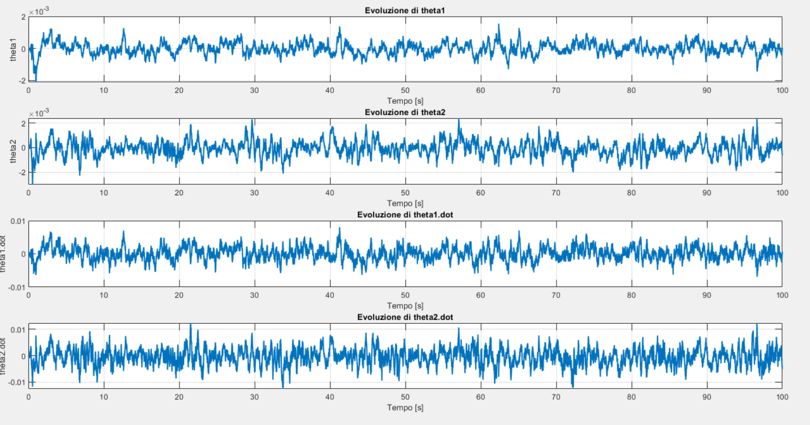
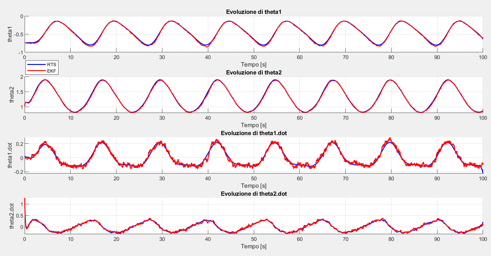
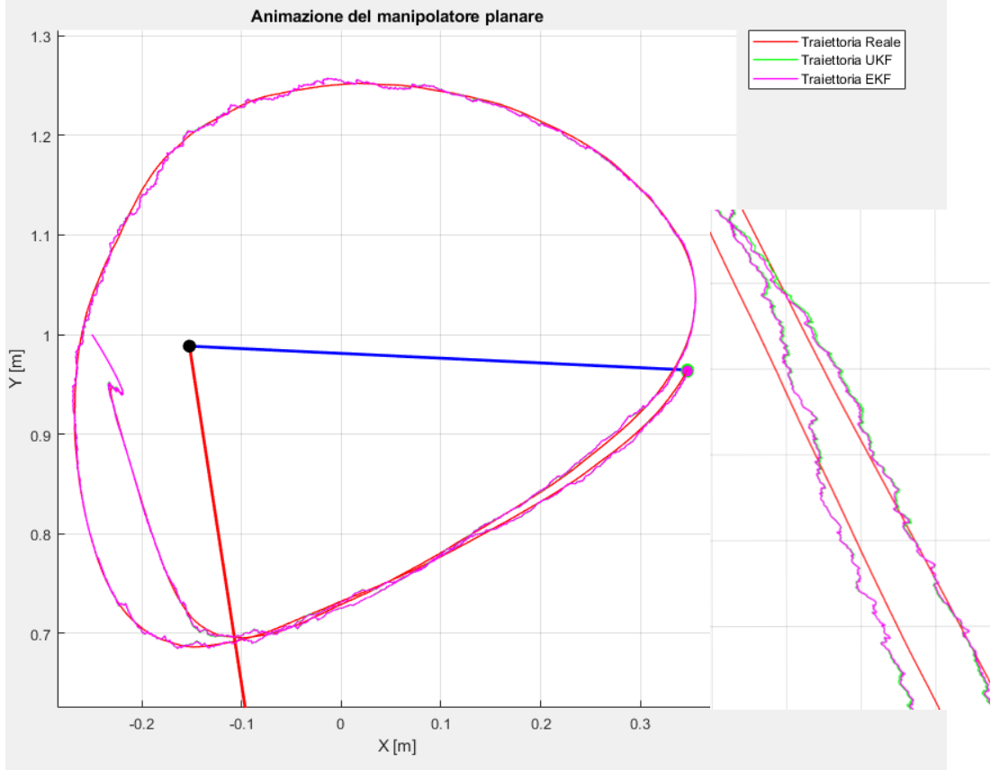

# State Estimation of a Planar RR Manipulator: EKF, UKF and RTS Smoother

Group project – *Identification of Uncertain Systems*, M.Sc. Robotics and Automation Engineering, University of Pisa (2025)
Authors: **Andrea Sodini**, Giulio Sergi, Matilda Ferri

The project estimates the joint angles and velocities of a two-link planar (RR) manipulator from noisy sensors, comparing nonlinear Bayesian filters and a fixed-interval smoother.

## System and sensors

- **RR manipulator** with link parameters inspired by medium-size industrial arms (l₁ = 1 m, l₂ = 0.5 m, M₁ = 20 kg, M₂ = 10 kg), viscous joint friction and torque disturbances, simulated in Simulink with dt = 1 ms.
- The model is validated through inverse kinematics against a desired end-effector position.
- **Optical encoder** with noise and outliers on the joint angle.
- **Ultrasonic sensor** measuring the distance to the elbow joint.

## Methods

- **Extended Kalman Filter:** analytical Jacobians for prediction (F, D) and correction (H, M).
- **Unscented Kalman Filter.**
- **Outlier rejection** with a Mahalanobis-distance gate (threshold = 4).
- **Filter consistency:** whiteness of the innovation checked with the Ljung–Box test (`lbqtest`).
- **Robustness analysis** with perturbed model parameters.
- **Rauch–Tung–Striebel (RTS) smoother** applied on top of the EKF.

## Results

- EKF and UKF give nearly overlapping estimates. Under model-parameter errors, the **UKF is more robust**, consistent with the innovation analysis.
- EKF + RTS smoothing gives the best estimate, especially on the joint velocities, when offline processing is acceptable.

| | |
|---|---|
|  |  |
| EKF vs UKF estimates | EKF vs EKF + RTS smoother |

The full report (in Italian) is in [`docs/report_it.pdf`](docs/report_it.pdf).

## How to run

MATLAB with Simulink, Statistics and Machine Learning Toolbox and Econometrics Toolbox (`lbqtest`). Run `src/main.m`, then `src/grafici.m` for the plots.

## Tech stack

`MATLAB` · `Simulink` · `EKF` · `UKF` · `RTS smoother` · `Bayesian estimation` · `Robot dynamics`
